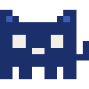

<div align="center">



# OMP Chat by DT

**An AI coding agent in your VS Code sidebar, with your own API keys.**

It reads your code, edits files and runs commands, in the spirit of Claude Code and GitHub Copilot Chat.<br>
Powered by the open-source [oh-my-pi](https://github.com/can1357/oh-my-pi) agent (`omp`).

[](https://github.com/thangws4/omp-chat)
[](https://code.visualstudio.com)
[](LICENSE)

[Quick start](#quick-start) · [Install](#install) · [Providers](#connect-a-provider) · [Using the chat](#using-the-chat) · [Troubleshooting](#troubleshooting)

</div>

---

## Highlights

| | |
|---|---|
| **Works with your keys** | OpenCode, OpenRouter, DeepSeek, Anthropic, OpenAI, Gemini, xAI, Mistral, Groq, Moonshot, Z.ai, or any compatible endpoint. Several keys per provider, switched automatically when one hits its limit |
| **Safe by default** | Asks before it edits files or runs commands; four approval modes plus a read-only **Plan** mode |
| **Reviewable changes** | Inline diffs for every changed file, **Undo**, and **Accept** / **Reject** per change in the editor |
| **Context in one keystroke** | The open file or selection goes with your message; `@` mentions files, folders, `@git`, `@problems`, `@terminal`, URLs; paste or drop images |
| **Built for long work** | Subagents, plans split across models, several chats at once, git worktree chats |
| **Know what it costs** | Context fill, tokens and cost per reply, 5-hour / weekly / monthly plan windows, free-model quota |
| **Picks up where you left off** | Conversations are saved and resume after a reload, even mid-turn |

## Quick start

1. **Install the extension** from a `.vsix` file ([details](#install)).
2. **Open the OMP Chat view** (the pixel-cat icon in the Activity Bar). If `omp` is missing, click **Install omp**, then **Retry**.
3. **Connect a provider**: pick one, paste an API key, and start chatting.

---

## Contents

- [Requirements](#requirements)
- [Install](#install)
- [Connect a provider](#connect-a-provider)
- [Using the chat](#using-the-chat)
- [API keys and limits](#api-keys-and-limits)
- [Plugins, skills and MCP](#plugins-skills-and-mcp)
- [Settings](#settings)
- [Commands and shortcuts](#commands-and-shortcuts)
- [Troubleshooting](#troubleshooting)
- [Privacy](#privacy)
- [Credits and license](#credits-and-license)

## Requirements

| | |
|---|---|
| VS Code | 1.85 or newer |
| [Bun](https://bun.sh) | 1.4.4 or newer (omp runs on Bun) |
| omp | `bun install -g @oh-my-pi/pi-coding-agent` |
| An API key | From one of the providers in [Connect a provider](#connect-a-provider) |

> **No need to install Bun or omp by hand:** if omp is missing, the panel offers to install it.

## Install

### The extension

**From a `.vsix` file** (the usual way to share it):

1. Build the package once, in the extension folder:
   ```bash
   npx @vscode/vsce package
   ```
   This creates `omp-chat-<version>.vsix`.
2. In VS Code: `Ctrl+Shift+P` → **Extensions: Install from VSIX…** → pick the file.
3. Reload VS Code when asked.

**From source** (to try or change it): open the extension folder in VS Code and press **F5**. A second VS Code window opens with OMP Chat loaded.

### omp

Open the **OMP Chat** view. If omp cannot be found, the chat shows:

> omp (oh-my-pi) was not found. OMP Chat needs it to run the agent.
> **[Install omp] [Set path…] [Retry]**

- **Install omp** opens a terminal and runs the install, so you can watch it and stop it.
  - If Bun is already installed: `bun install -g @oh-my-pi/pi-coding-agent`
  - If not: Bun's official installer runs first (`irm bun.sh/install.ps1 | iex` on Windows, `curl -fsSL https://bun.sh/install | bash` on macOS/Linux), then omp.
- When the terminal is done, click **Retry**. No VS Code restart needed: OMP Chat finds a freshly installed omp even if it is not on VS Code's PATH yet.
- **Set path…** is for an omp installed somewhere unusual: enter the full path to the `omp` executable.

<details>
<summary>Install by hand instead</summary>

```bash
# Windows (PowerShell)
irm bun.sh/install.ps1 | iex
bun install -g @oh-my-pi/pi-coding-agent

# macOS / Linux
curl -fsSL https://bun.sh/install | bash
bun install -g @oh-my-pi/pi-coding-agent
```

Check it with `omp --version`.

</details>

## Connect a provider

The first time you open the panel, a **Connect a model provider** form appears at the top of the chat. Pick a provider, paste a key, and optionally give the key a name (for example `work`). Press **Skip** if omp already has a login of its own; you can add keys later from **…** → **Set API Key…**.

Have a ChatGPT, Claude or Copilot plan instead of a key? **…** → **Sign in with a subscription…** runs `omp login` in a terminal: pick the provider, finish signing in in the browser, and the chat restarts with that plan's models.

| Provider | What you get | Get a key |
|---|---|---|
| **OpenCode Go** | $10/month plan with many models (DeepSeek V4.1 Flash, Kimi, GLM, Qwen, MiniMax…). Limits per 5 hours, week and month | [opencode.ai/go](https://opencode.ai/go) |
| **OpenCode Zen** | Pay-per-use gateway. Its `-free` models are meant for the OpenCode app: used from other tools such as omp, the free allowance runs out quickly | [opencode.ai/console](https://opencode.ai/console) |
| **OpenRouter** | Hundreds of models; `:free` models cost nothing (50 requests/day, 1,000 after buying $10 of credits) | [openrouter.ai/keys](https://openrouter.ai/keys) |
| **DeepSeek** | DeepSeek's own API, pay per token | [platform.deepseek.com](https://platform.deepseek.com/api_keys) |
| **Anthropic** | Claude models, pay per token | [platform.anthropic.com](https://platform.anthropic.com/settings/keys) |
| **OpenAI** | GPT models, pay per token | [platform.openai.com](https://platform.openai.com/api-keys) |
| **Google Gemini** | Gemini models, free tier available | [aistudio.google.com](https://aistudio.google.com/apikey) |
| **xAI** | Grok models, pay per token | [console.x.ai](https://console.x.ai) |
| **Mistral** | Devstral / Codestral, free tier available | [console.mistral.ai](https://console.mistral.ai/api-keys) |
| **Groq** | Fast open models, free tier available | [console.groq.com](https://console.groq.com/keys) |
| **Moonshot** | Kimi models, pay per token | [platform.moonshot.ai](https://platform.moonshot.ai/console/api-keys) |
| **Z.ai** | GLM models | [z.ai](https://z.ai/manage-apikey/apikey-list) |

**Base URL (optional).** Fill it in to send that key's requests to a proxy, gateway or other compatible endpoint (for example `https://my-proxy.example.com/v1`) instead of the provider's own. It belongs to the key: it applies while that key is active, and the key list shows it next to the key. To change or clear it later, use the 🌐 button on the key in the key list.

**Usage URL (optional).** A gateway's own endpoint for the key's quota, with `{key}` where the key goes. For example, a Zyloris key uses base URL `https://claude.zyloris.com/v1` and usage URL `https://zyloris.com/api/gateway/subscription/check?apiKey={key}`. **Usage & limits** then shows what that endpoint returns, under **Gateway usage**; any key the gateway sends back is left out. The key is also sent as `Authorization: Bearer` and `x-api-key` headers. Set or change it with the same 🌐 button.

**OpenCode Go and Zen** use the same OpenCode key (create it at [opencode.ai/console](https://opencode.ai/console) with the **Models: Request** permission, plus **Usage: Read** for the usage panel). Every `opencode-go/…` model needs the Go subscription, including the ones whose names end in `-free`; the model list marks them **Go plan**.

After you save a key, OMP Chat switches to a default model of that provider if the current model has no key, and restarts omp so it picks up the key. Your conversation is kept.

> Prices and free offers change often, so check the provider's page.

## Using the chat

### Asking

Type in the box at the bottom and press **Enter** (**Shift+Enter** for a new line). While the agent works, the send button turns into ■ **Stop** (same spot, like Claude Code); start typing and it turns back into send, which queues your message. **Esc** also stops the agent.

A message sent while the agent is working is **queued**: it waits above the box, marked *Queued*, until the agent can take it. Use ↑ to hand it to the running turn right away, or ✕ to take it back into the box.

When the agent keeps a to-do list, it is pinned above the box (**Todos 2/5**): ✓ done, ⟳ in progress, ○ to do. Click the header to fold it.

What goes with your message sits in a row at the top of the box: **Add context** (`@`), the open file and any pinned files. The bar under the text has the approval mode on the left; on the right the context ring (with a percentage once it is half full), the model with its effort (`deepseek-v4-flash · high`), `/` for commands, **+** to attach files or images, and send. In a narrow sidebar the labels fold into icons; their tooltips still say everything.

| In the message box | What it does |
|---|---|
| 👁 file name at the top of the box | The open file is sent with your message. With a selection, it shows the line range and the selected code is sent. Click to leave the file out (struck through) or put it back; a newly opened file is included again |
| 📌 next to the file name (on hover) | Keeps that file attached to every message, even after you switch files. Pinned files show as their own chips; ✕ removes one. Also: right-click a file in the Explorer (or an editor tab) → **Add File to OMP Chat** |
| `@` | Lists workspace files as you type (`@cal…`). **↑ ↓** to move, **Enter** or **Tab** to insert, **Esc** to close. **Add context** does the same |
| `@problems` | Sends the errors and warnings from VS Code's **Problems** panel |
| `@terminal` | Sends the recent output of the active terminal (copied through the clipboard, which is put back afterwards) |
| `@git` | Sends what you have not committed yet: `git status` and the diff against `HEAD` |
| `@src/` | A folder: omp sends the list of its files. Folders are in the `@` list too |
| `@https://…` | Fetches the page and sends it as text (up to 3 links per message, 20,000 characters each) |
| Images and files | Use the **+** button, paste with **Ctrl+V**, or drag them anywhere onto the panel (from your file manager, or from VS Code's Explorer and tabs; hold **Shift** while dropping if VS Code opens the file instead). Images (up to 5, large ones scaled down) go to the model directly, so it must support images. Other files (up to 10, 20 MB each) show as chips and the agent reads them: PDF, Word (.docx), Excel (.xlsx), PowerPoint (.pptx), EPUB, text and code. Old .doc / .xls / .ppt files cannot be read; save them in the newer format first |
| `/` | Lists omp's slash commands, for example `/session`, `/compact`, `/retry`, `/mcp` |
| `!` | Runs the rest as a shell command in the workspace (the box switches to shell mode). See [Terminal](#terminal) |
| `#` | Saves the rest of the line to the project's memory (`AGENTS.md`) instead of sending it. See [Memory](#memory) |
| ↑ / ↓ in an empty box | Brings back the messages you sent before, like a shell. What you are typing is kept if the window reloads |

The start screen offers ready-made requests about the open file (**Explain this file**, **Find and fix bugs**, **Write tests**), your three latest conversations under **Recent** (one click picks one up again; **All chats** lists the rest), and the main shortcuts.

In replies, a file path such as `src/app.ts:42` is a link that opens the file at that line. Code blocks have **Insert at cursor** (into the editor you were last in), **Open in new file** and **Copy**.

Under each finished reply: 📋 copies the whole answer as Markdown, followed by what the turn used, for example `13k in · 312 out · $0.0021 · 14s` (tokens sent and received, cost as priced by omp, time).

### From the editor

- Right-click in a file: **Ask OMP Chat** (opens the chat with the file or selection attached), **Explain with OMP Chat** (when code is selected) and **Fix with OMP Chat**.
- On a red or yellow squiggle, the light bulb (**Ctrl+.**) offers **Fix with OMP Chat**: the problems on that line go to the agent.

### Agent status at a glance

You can see what the agent is doing even with the panel closed:

| | Panel title | Activity Bar icon | Status bar |
|---|---|---|---|
| Waiting for you (an approval or question is open) | 🔴 waiting for you | badge ① | **OMP: needs you** (highlighted) |
| Working | 🟡 working | | OMP: working |
| Finished while the panel was hidden | 🔵 done | badge ① | OMP: done |
| Idle | | | hidden |

Click the status bar item to open the chat (with several chats, the one that needs you). Opening the panel clears "done".

### Approvals

The agent can always read files. Whether it must ask before changing anything depends on the mode in the box's toolbar; **Shift+Tab** cycles through them.

| Mode | Asks before |
|---|---|
| **Ask before edits** (default) | Every file change and every command |
| **Ask & remember** | The same, but you can approve a file or folder for the rest of the session |
| **Auto-approve edits** | Commands only |
| **Full auto** | Nothing |
| **Plan (read-only)** | Nothing: every edit and command is refused. The agent studies the code and writes a plan |

A request shows as a card in the chat, for example **Allow tool: edit — File: calc.py** with **Approve / Approve edit for this session / Deny**. Once answered it shrinks to one line. Changing the mode restarts omp and keeps the conversation. When omp needs a typed answer, the card has a text box; multi-line boxes submit with **Ctrl+Enter**.

**Allowed commands.** Commands you trust run without a card, in every mode except Plan. A command's card offers **Always allow** *pattern* (its first two words and anything after, e.g. `npm test*`), which adds the pattern to `ompChat.allowedCommands`; edit that setting to change or remove patterns. A pattern must match the whole command, `*` matching anything. A command with `&&`, `|`, `;`, `$(…)` or `>` always asks, and so does one omp flags as dangerous.

### Plans and subagent splits

In **Plan** mode the agent writes the plan as numbered tasks (what to do, files, how to check it, how hard it is, what it depends on). When the plan is written a card asks **Execute, ask before edits**, **Execute, auto-approve edits**, **Split across subagents** or **Keep planning**. Executing switches to that mode and asks the agent to carry out the plan in the same conversation.

**Split across subagents** makes the agent the lead: each task goes to its own subagent with a self-contained brief, tasks that do not depend on each other run in parallel, and the lead then reviews the changes together, runs the checks and sums up per task. Edits are auto-approved; commands still ask.

Each task runs on the model that suits it, picked from **your models** (★ in the model list) plus the one in use: the strongest for design or tricky debugging, a faster or cheaper one for search, docs or small edits, each with its own effort. OMP Chat allows exactly those models for subagents (omp's `task.perCallModel`, set for this run only; omp's own settings are not changed), and each subagent card shows the model it runs on.

> Star at least one model besides the current one to use this. Changes to your models apply the next time omp starts (executing a plan restarts it).

### Changes to your files

Every tool the agent runs is a compact row (✓ done, ✕ failed); click it to see the output. Edited files are listed under **N files changed** with the number of added and removed lines. Approving an edit shows the lines it will change in the approval card.

- **A file's row**: opens or closes its diff in the chat (small changes start open).
- **Review** (📄 button): opens the file for review in the editor, see below.
- **Diff** button: VS Code's side-by-side diff of that edit.
- **Undo**: puts the file back as it was before that edit (a file the agent created is deleted). If the file changed again afterwards, OMP Chat asks first. The agent is told about the undo with your next message.

### Reviewing in the editor

A file the agent edits stays under review until you settle every change in it:

- Added and changed lines are highlighted. Where lines were removed, the end of the line shows how many and the first of them (`−3  let sum = 0;  …`); hover it to see them all.
- **Accept** / **Reject** above each change keep it or put it back; **Accept all** / **Reject all** at the top settle the whole file. **Compare** opens VS Code's diff editor against the file as it was before the agent's edits.
- The status bar shows how many changes are left (**3 changes to review**); click it to go to the next one.
- Rejected parts are saved to disk, and the agent is told with your next message. The review lasts until every change is settled (or VS Code reloads).

| Key | While reviewing |
|---|---|
| `F7` / `Shift+F7` | Next / previous change, on to the next file under review |
| `Alt+Y` (`⌘⌥Y`) | Accept the change at the cursor, then go to the next one |
| `Alt+N` (`⌘⌥N`) | Reject the change at the cursor, then go to the next one |

### Subagents

omp can hand parts of a job to **subagents** (its `task` tool): helpers with their own context, such as `scout` (fast read-only exploration), `reviewer`, `security-reviewer`, or agents you define in `.omp/agents/*.md` (project) or `~/.omp/agent/agents/*.md` (yours). They often run in the background while the main agent keeps going.

- Each one gets a **card** under the *Delegated to* row: its type, name, the job, what it is doing right now, time and tool count. The left edge is yellow while it runs, green when done, red if it failed.
- The map button on a card opens it in the **subagent map** (below), with its conversation open.
- 💬 **Steer** sends it an extra instruction; ■ **Stop** cancels just that subagent.
- While any run, a **Subagents** bar sits above the input (click a row to jump to its card, **Open map** for the map) and the status bar reads *OMP: working · N subagents*.

#### Subagent map

**Open map** (or **OMP Chat: Subagent map** in the Command Palette) opens a tab that fills the editor: the run as a tree. The lead sits on top with its model, your request and the time since you sent it; each subagent hangs under the agent that spawned it, nested ones included, with the model it runs on (one colour per provider), a live timer, its task and its last 3 steps (**+N more steps**). Finished ones fold to *Done · N steps*. Each chat has its own map, and it never opens by itself.

Click an agent to open **its conversation** beside the tree (below it when the tab is narrow; drag the edge to resize): the task, what it says and every tool call, following it live. Type in the box at the bottom to steer it while it runs; ■ stops it.

The lead decides by itself when to split work into subagents, and which of **your models** (★) suits each task, in every chat, not only after **Split across subagents**.

### Terminal

- **Commands the agent runs** show as **Ran** *command* rows. While a command runs, its output streams into the row; when it finishes the row folds (click to open it again).
- **Your own commands**: start a message with `!`, for example `!npm test`. The command runs in the workspace and shows on your side of the chat with its output and exit code (■ stops it). The command and its output become part of the conversation, so the agent sees them with your next message.
- **Run in terminal** (⌨ on any command row or `!` block) runs the same command in VS Code's terminal **OMP Chat**, to watch it or answer its prompts.

### Models

Click the model name in the toolbar to open the model list. Each model shows its name, and under it the provider, context window, whether it reads images, and the price per million tokens in / out (for example `anthropic · 1M ctx · images · $2 / $10`). Type to filter by name or id (`free`, `deepseek`, `kimi`…). Badges say **free**, **Go plan** (needs the OpenCode Go subscription) or **used up** (free allowance spent, with the time until it resets). **Manage models…** stays at the bottom.

The **Effort** row sets how much the model thinks before answering: `low`, `medium`, `high` (the default) or `max`, as in Claude Code. The choice shows after the model name and applies to the running conversation. Models without reasoning ignore it.

**Your models.** The model list shows only your models (★) plus the one in use. **Manage models…** (last entry of that list, or **…** → **Manage Models…**) shows every model omp can run, with a filter and one-click filters for **free**, **go plan** and **images**: click ☆ to add a model to your models, click the model itself to switch to it. Your models sit on top, where ↑ ↓ (on hover) set their order and ✕ removes one. They are kept across workspaces.

<details>
<summary>Keyboard in <b>Manage models…</b></summary>

| Key | |
|---|---|
| **↓** | From the filter into the list |
| **↑ ↓** | Move |
| **Enter** | Use the model |
| **Space** | Star or unstar it |
| **Alt+↑ ↓** | Reorder your models |
| Any letter | Filter again |
| **Esc** | Close |

The filter text is remembered.

</details>

Switching models keeps the conversation: the next message continues it on the new model. If the new model's provider has no key yet, OMP Chat asks you to add one first.

### Rewind

Hover over one of your messages and click ↶ to go back to just before it:

- **Rewind conversation**: the conversation continues from before that message, and the message returns to the box so you can edit and resend it.
- **Rewind and restore code**: the same, and every file change the agent made from that message on is undone, newest first. The agent is told which files were restored.

The longer conversation is kept as an earlier chat (🕘). In a reopened conversation, files the agent *created* with the write tool cannot be restored (their earlier state was not recorded); edits can.

### Conversations

- Reloading the window reopens the last conversation of the workspace. If the agent was in the middle of a turn when the window closed, the chat says so and offers **Continue**.
- **+** (title bar) starts a new chat.
- **🕘** (title bar) lists the conversations of this workspace (up to 100), grouped by day with the time or date, the open one marked **current**. Type to filter; **Enter** opens the latest other conversation (or the one you move to). Their diffs and **Undo** buttons work again. Hover a conversation for ✏ (**F2**) to rename it and 🗑 (**Del**) to move it to the trash; **New chat** at the top starts a new one.
- **…** → **Export Chat as Markdown** opens the conversation as a Markdown document (your messages, replies, tool calls and shell commands) to save or share.
- When the context window is 80% full, the chat suggests **Compact now** (`/compact`): omp replaces the older part of the conversation with a summary and frees the space.

Conversations are stored by omp in `~/.omp/agent/sessions/`.

### Several chats at once

You can have more than one chat working at the same time, each with its own omp and conversation.

- **…** → **Open Chat in New Tab**: a chat in an editor tab, next to your code. Its title shows its state (🟡 working, 🔴 waiting for you, 🔵 done); its tab bar has New chat, Chats and Usage.
- **…** → **New Chat in Git Worktree…**: the same, but the chat works on its own branch, checked out in a separate folder next to the project (`<project>.worktrees/<branch>`), so its edits never touch your files or another chat's. When you close the tab, a worktree with no changes is removed with its branch; one with changes is kept so you can review and merge the branch.
- **…** → **Show All Chats** lists every chat with its state and model; pick one to go to it.
- The status bar sums them up (*OMP: needs you · 2 chats*); clicking it goes to the chat that needs you.
- Tabs come back after a reload with their conversation. Settings (model, approval mode, keys) are shared by all chats.

### Notifications

When a chat asks for your answer while it is hidden or VS Code is in the background, or finishes while VS Code is in the background, a VS Code notification says so, with **Open**. Turn it off with `ompChat.notifications`.

### Memory

Start a one-line message with `#` to save a note for the agent instead of sending it, as in Claude Code: `# use pnpm, not npm`. It is added to the project's `AGENTS.md` (or `CLAUDE.md`, if that is the one the project has), which omp reads at the start of every conversation. The current conversation is told right away.

## API keys and limits

### Several keys

**…** → **Set API Key…** opens the key list in the panel. Each provider you have keys for gets a card:

- Click a key to **use** it (the one in use is marked **in use**); omp restarts with it and the conversation continues
- **+** on a card adds another key for that provider (the newest becomes the active one)
- Hover a key for **Rename** (✏), **Base URL** (🌐, shown under the key when set) and **Remove** (🗑, click twice to confirm)

Providers without a key are listed below as **+ Provider** chips; click one to add its key.

When a request fails because a limit or credit ran out (HTTP 429 / 402, "rate limit", "quota"…), OMP Chat moves to the provider's next key, restarts omp on the same conversation and retries the turn with `/retry`. When every key is spent, it offers **Choose another model**, **Manage keys** and **Usage & limits**.

### Usage & limits

Open it with the 📊 button in the title bar or the context ring in the toolbar (with the OpenCode Go plan it also shows `5h 37%`; hover for the numbers).

| Section | Shows |
|---|---|
| This chat | Four tiles: cost, tokens (in / out / share served from cache), model and tool calls, and how full the context window is |
| OpenCode Go plan | 5-hour, weekly and monthly usage, each with a bar that turns yellow from 75% and red from 90% or when the limit is reached, and the time until it resets |
| Today (UTC) | OpenRouter free-model requests used out of your daily quota |
| OpenRouter account | Credits used today / this month / in total, key limit |
| DeepSeek account | Balance |
| Gateway usage | For a key with a usage URL: plan and status, a token bar (from `…Used` / `…Limit` fields) with its reset, days until the plan expires, and why the key is blocked if it is; every other field under **Details**. The toolbar shows `quota 22%` |
| API keys | Every saved key of the current provider with its limits as badges (red when full); click a key to switch to it |

Account figures need the key saved in OMP Chat (keys that only omp knows about cannot be read).

## Plugins, skills and MCP

### Plugins & skills panel

The 🧩 button in the title bar (or **OMP Chat: Plugins & Skills**) lists every skill the agent can use here, in two parts: **Skills** (your own and the project's) and **Plugins** (each installed Claude Code plugin, which omp picks up automatically), each as a card with how many of its skills are on.

- **Switch a plugin on or off** with the switch on its card, or click the card to open it and switch single skills. A half-filled switch means some of its skills are on. Hover a skill for its full description.
- **Filter** by name or description.
- **Apply** (enabled once something changed; the footer counts the changes) restarts the agent with your choice and keeps the conversation. The choice applies to this workspace only; Claude Code's and omp's own settings are not changed.
- **Auto-pick skills for each message**: switched-on skills are always offered to the agent, which chooses among them (as in Claude Code). With auto-pick on, OMP Chat also names up to three skills that match your request (it understands common Vietnamese requests too), and shows *Auto-picked skills: …* in the chat. When the agent opens a skill, its row reads **Using skill** *name*.

### Your own commands

A command is a saved prompt you send by typing `/name`. **…** → **Custom Commands…** (or **Your commands…** at the end of the `/` list) shows them:

- **New command…**: a name, a description, an optional argument hint and the prompt. `$ARGUMENTS` in the prompt is replaced by what you type after the name, so `/review src/app.ts` sends the prompt about that file.
- **Save for** this project (`.omp/commands/<name>.md`, can be committed and shared with your team) or all projects (`~/.omp/agent/commands`).
- Commands are grouped into **This project** and **All projects** (`.claude` marks Claude Code's). Click one to put it in the message box; hover it for ✏ (opens the file to edit) and 🗑 (click twice; the file goes to the trash).

Claude Code commands (`.claude/commands/*.md`) are listed and work too.

### MCP servers

**…** → **MCP Servers…** lists the servers in this project (`.omp/mcp.json`) and in your user settings:

- the switch turns a server on or off, ▷ tests the connection, 🗑 removes it (click twice);
- **Add server…** takes a name and either a command (a local server, e.g. `npx -y @modelcontextprotocol/server-filesystem .`) or a URL (a remote server);
- servers start with the agent, so after a change a banner offers **Restart agent** (the conversation is kept).

Servers that need a browser sign-in (OAuth) have to be authorized once in omp's terminal app.

### omp commands

These come from omp and work through `/` commands in the chat:

| Command | |
|---|---|
| `/marketplace add <source>` then `/marketplace install <plugin>` | Plugins from marketplaces; omp reads Claude Code-style marketplaces (`marketplace.json`) and `.claude/plugins` |
| `/plugins list`, `/plugins enable <name>`, `/plugins disable <name>` | Manage installed plugins; `/reload-plugins` reloads them |
| `/skill:<name>` | Run a skill. Skills in `~/.claude/skills` and the project's `.claude/skills` show up automatically |
| `/mcp add`, `/mcp list`, `/mcp test` | MCP servers |

Type `/` to see everything available on your machine.

## Settings

**Language**: the panel, menus and settings follow VS Code's display language. Vietnamese is included (**Configure Display Language** → Tiếng Việt, then reload). Your messages, the agent's replies and code are never translated.

| Setting | Default | |
|---|---|---|
| `ompChat.model` | `openrouter/baidu/ernie-5.5-flash-preview:free` | Model as `provider/model`; the model picker writes this |
| `ompChat.thinkingLevel` | `high` | Effort: `minimal`, `low`, `medium`, `high`, `xhigh` or `max`. Also the **Effort** row of the model list |
| `ompChat.approvalMode` | `always-ask` | `always-ask`, `always-ask-cached`, `write`, `yolo` or `plan` (the [approval modes](#approvals)) |
| `ompChat.allowedCommands` | `[]` | Commands that run without asking, e.g. `["npm test*", "git status"]` |
| `ompChat.notifications` | `true` | Notify when a chat needs you or finishes while you are elsewhere |
| `ompChat.announceSteps` | `true` | The agent says what it is about to do, gives short updates while it works and sums up at the end, as in Claude Code (added to omp's system prompt; a `--append-system-prompt` in `extraArgs` replaces it) |
| `ompChat.ompPath` | `omp` | Path to the omp executable |
| `ompChat.extraArgs` | `[]` | Extra omp command-line arguments |

## Commands and shortcuts

| Command (`Ctrl+Shift+P`) | Also in |
|---|---|
| OMP Chat: Open | Activity Bar icon |
| OMP Chat: New Chat | **+** in the title bar |
| OMP Chat: Show Chats… | **🕘** in the title bar |
| OMP Chat: Usage & Limits | **📊** in the title bar |
| OMP Chat: Plugins & Skills | **🧩** in the title bar |
| OMP Chat: Choose Model… | Model name in the toolbar, or **…** menu |
| OMP Chat: Manage Models… | **…** menu, or "Manage models…" in the model list |
| OMP Chat: Set API Key… | **…** menu |
| OMP Chat: Export Chat as Markdown | **…** menu |
| OMP Chat: Custom Commands… | **…** menu, or the end of the `/` list |
| OMP Chat: MCP Servers… | **…** menu |
| OMP Chat: Add File to OMP Chat | Right-click a file in the Explorer or an editor tab |
| OMP Chat: Ask / Explain / Fix with OMP Chat | Right-click in the editor; Fix also in the light bulb |
| OMP Chat: Stop Agent | **■** / **Esc** |
| OMP Chat: Open Chat in New Tab | **…** menu |
| OMP Chat: New Chat in Git Worktree… | **…** menu |
| OMP Chat: Show All Chats | **…** menu, or the tab's title bar |
| OMP Chat: Go to the Chat That Needs You | Status bar item |
| OMP Chat: Next / Previous Change to Review | `F7` / `Shift+F7`, or the review status bar item |
| OMP Chat: Accept / Reject Change at Cursor | `Alt+Y` / `Alt+N`, or the lenses above each change |
| OMP Chat: Compare with the File Before OMP's Edits | **Compare** lens at the top of a file under review |

| Key | Where | |
|---|---|---|
| `Ctrl+Alt+O` (`⌘⌥O`) | Anywhere | Open the chat |
| `Ctrl+Alt+A` (`⌘⌥A`) | Editor | Ask OMP Chat about the file or selection |
| `Enter` / `Shift+Enter` | Message box | Send / new line |
| `!` at the start | Message box | Shell mode: run the message as a command |
| `↑` / `↓` | Empty message box | Earlier messages you sent |
| `Shift+Tab` | Message box | Next approval mode |
| `Esc` | Message box | Stop the agent (or close an open list) |
| `↑ ↓`, `Enter`, `Tab` | Lists | Move and pick in `/`, `@`, model and chat lists |

Change the global ones in **Keyboard Shortcuts** (search `OMP Chat`).

## Troubleshooting

| You see | What to do |
|---|---|
| "omp (oh-my-pi) was not found" | Use **Install omp**, then **Retry**; or **Set path…** |
| "401 … invalid" or "No API key found" | The key is wrong or missing: **…** → **Set API Key…**. With a base URL, check that the endpoint accepts that key |
| "… needs a *Provider* key" after picking a model | Add a key for that provider; the conversation continues on that model |
| "429", "rate limit", "quota" | OMP Chat switches keys by itself; add another key, wait for the reset shown in **Usage & limits**, or pick another model |
| "Free usage limit reached … (FreeUsageLimitError)" | The OpenCode free allowance of your account is used up. Keys of the same account share it, so OMP Chat does not switch keys; the message says when it resets. Pick another model meanwhile |
| "403 An active OpenCode Go subscription is required" | `opencode-go/…` models need the Go plan. Subscribe, or pick a model from another provider |
| The reply says a file was created, but it is not there | The model only described the change without calling a tool (common with small free models). OMP Chat flags this when it can. Ask again ("use the write tool to create it") or pick a stronger model |
| The model ignores images | Pick a model that accepts images (the model list on the provider's site says so) |
| Nothing happens / blank panel | `Ctrl+Shift+P` → **Developer: Reload Window**. For details, **Developer: Open Webview Developer Tools** → Console |

## Privacy

- API keys are kept in VS Code's encrypted Secret Storage and handed to omp as environment variables. They are sent only to the provider they belong to, or to the base URL and usage URL you set for that key.
- Your messages, the files the agent reads, and attached images go to the model provider you selected. Check each provider's data policy; some free models may use requests for training.
- Conversations are stored locally by omp in `~/.omp/agent/sessions/`.

## Credits and license

- Agent: [oh-my-pi](https://github.com/can1357/oh-my-pi)
- Icons: [VS Code Codicons](https://github.com/microsoft/vscode-codicons) (CC BY 4.0), bundled in `media/vendor/codicons`
- Markdown: [markdown-it](https://github.com/markdown-it/markdown-it) (MIT), bundled in `media/vendor`

OMP Chat is released under the [MIT License](LICENSE).
